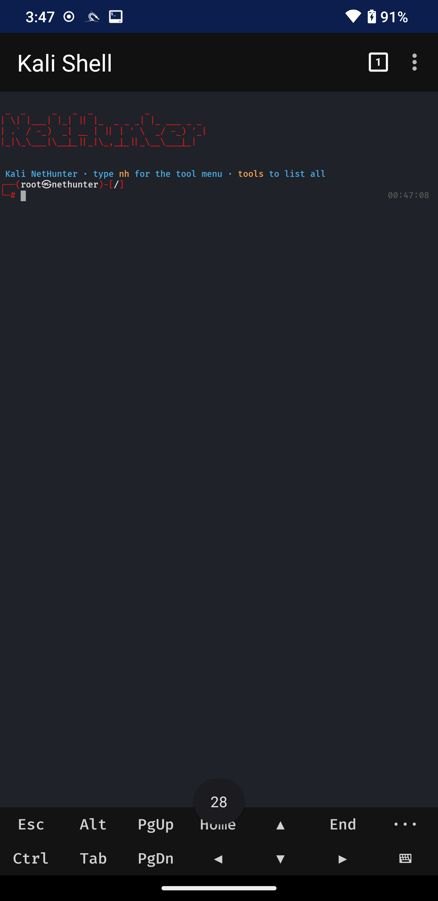
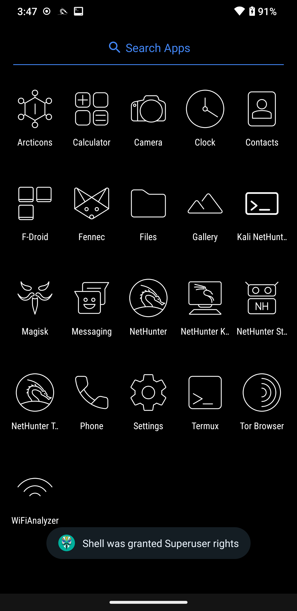

<div align="center">


# Kali NetHunter — Kernel + Terminal Blueprint

**A complete, reproducible recipe for bringing full Kali NetHunter to a rooted Android phone:**
build a custom NetHunter kernel, flash it without a bootloop, enhance the Kali shell,
make external USB Wi-Fi work, theme the whole device, and ship a one-tap launcher — all
documented end to end, with a set of **Claude Code agents** that repeat it on any phone.

Demonstrated on a **Samsung Galaxy Note 9 (SM-N960F · crownlte · Exynos 9810)** running
**LineageOS 20 / Android 13** with **Magisk**, but written as a blueprint for **any rooted device**.


</div>

> [!WARNING]
> **Authorized use only.** This project is for security research, education, and testing on
> devices and networks **you own or are explicitly permitted to test**. Flashing a kernel can
> brick a device — always keep the stock backup (`boot/recovery.sh` restores it). You accept all risk.

---

## What you get

| | |
|---|---|
| 🧩 **Custom NetHunter kernel** | USB HID (BadUSB), USB mass-storage gadget, `mac80211` + Wi-Fi injection, in-tree external USB Wi-Fi drivers (Atheros `ath9k_htc`, Realtek `rtl8xxxu`/`rtl8187`, Ralink `rt2800usb`, `carl9170`, `zd1211rw`). |
| 🐚 **Enhanced Kali shell** | `zsh` with the authentic Kali two-line prompt, autosuggestions, syntax highlighting, tab-completion, and an interactive `nh` / `tools` launcher — plus a **Ctrl+C fix** so interrupting a tool no longer closes the terminal tab. |
| 📡 **External USB Wi-Fi** | The **RTL8812BU** driver built as a **Magisk module** (no reflash) → plug adapter, get `wlan1`, monitor mode + injection. Includes the `-fno-stack-protector` fix that stops a PAN-fault reboot on probe. |
| 📱 **One-tap launcher app** | A signed APK (`com.oph.nethunter`) that opens the NetHunter Terminal straight into the enhanced Kali shell. Built **without Gradle**. |
| 🎨 **Full Kali theme** | Black theme + Kali-blue accent, dragon wallpaper, Lawnchair + Arcticons line-art icons, debloat + privacy apps. |
| 🛟 **Bootloop-proof flashing** | Auto-detects the stock kernel format (raw vs gzip), keeps the Magisk ramdisk + device tree, and ships a tested stock-restore recovery path. |
| 🤖 **Claude Code agents** | A `.claude/agents/` set that ports this whole thing to a **different** phone, phase by phase, with every gotcha baked in. |

<div align="center">

&nbsp;

&nbsp;

<br/>
<sub>One tap into the Kali shell · enhanced zsh prompt · dark drawer with uniform Arcticons icons</sub>
</div>

---

## Architecture

<div align="center"></div>

The only piece that must be **compiled** is the kernel. Everything above it (Magisk, the Kali
chroot, NeoTerm) already exists — the kernel is what unlocks HID attacks and Wi-Fi monitor/injection,
and a Magisk module adds the external USB Wi-Fi driver on top without another reflash.

---

## Prerequisites

- A **rooted** phone (Magisk) with Kali NetHunter installed (the app + chroot + NetHunter Terminal).
- A Linux build host (or VM) with ~20 GB free, `adb`, and internet.
- `magiskboot` on the phone (ships with Magisk at `/data/adb/magisk/magiskboot`).
- Your device's kernel source + the Google clang your stock kernel was built with.

> There is **no prebuilt NetHunter kernel** for crownlte on LineageOS 20 — that is exactly why
> this blueprint compiles one. For other devices, swap the kernel repo/branch in `kernel/build.sh`.

---

## Step by step

### 1 · Back up and pull the real config

```bash
# keep a known-good backup FIRST — this is your lifeline
adb shell su -c 'dd if=/dev/block/by-name/BOOT of=/sdcard/boot-stock.img'
adb pull /sdcard/boot-stock.img ./boot-stock.img
# the config that actually boots your phone (NOT a defconfig — that can bootloop)
adb shell su -c 'zcat /proc/config.gz' > running.config
```

### 2 · Build the kernel

```bash
RUNNING_CONFIG=$PWD/running.config ./kernel/build.sh
```

Key choices baked into [`kernel/build.sh`](kernel/build.sh):

- **Base `.config` = the phone's own `/proc/config.gz`.** A plain `*_defconfig` build is missing
  device-critical options and bootloops. This was the difference between a 14 MB dud and a working kernel.
- **clang compiles, GNU `as` assembles.** Old kernels break clang's integrated assembler on the VDSO
  (`too many positional arguments`). `-no-integrated-as` with the Google binutils fixes it.
- **Relax `-Werror`** for the out-of-tree Wi-Fi drivers under newer clang.
- NetHunter patches come from Kali's official
  [`kali-nethunter-kernel-builder`](https://gitlab.com/kalilinux/nethunter/build-scripts/kali-nethunter-kernel-builder)
  (`patches/4.09`) via [`kernel/apply-patches.sh`](kernel/apply-patches.sh); extra `CONFIG` symbols live in
  [`kernel/config-fragment.txt`](kernel/config-fragment.txt).

### 3 & 4 · Repack and flash — *mind the format*

<div align="center"></div>

This is the trap that bootloops most people. The crownlte boot image stores the kernel as a **raw,
uncompressed arm64 `Image`** (`'ARMd'` magic at `0x38`) with the device tree in a separate **DTBH**
section — the bootloader does **not** gunzip. Flash a `Image.gz-dtb` there and it jumps into gzip
bytes and dies on the Samsung logo.

[`boot/repack-and-flash.sh`](boot/repack-and-flash.sh) auto-detects the format, swaps **only** the
kernel (keeping the Magisk ramdisk so root survives and the DTBH so hardware matches), then `dd`s it:

```bash
adb push out/arch/arm64/boot/Image /sdcard/nh-backup/Image
adb shell su -c 'sh /sdcard/.../repack-and-flash.sh'
adb reboot
```

### Recovery (if it bootloops)

Nothing is lost — the kernel only lives in the boot partition. From stock recovery:

```bash
./boot/recovery.sh        # pushes boot-stock.img and dd's it back
```

Samsung combos (USB plugged in): force-off = **Vol Down + Power** (~10 s); recovery = **Vol Up + Bixby + Power**.

---

## 5 · Enhance the Kali shell (+ the Ctrl+C fix)

```bash
adb push shell/setup-kali-shell.sh /sdcard/ && \
adb shell su -c 'sh /path/bootkali custom_cmd bash /root/setup-kali-shell.sh'
```

Installs `zsh` + autosuggestions + syntax-highlighting, writes the Kali-style prompt, and adds:

- **`nh`** — an interactive, categorized launcher (recon / scanning / exploitation / wireless / web / passwords) that pre-fills ready-to-run commands.
- **`tools`** — a color-coded inventory of the installed toolkit.

[`nhterm-fix/fix-nhterm-kali.sh`](nhterm-fix/fix-nhterm-kali.sh) makes the NetHunter Terminal's "Kali Shell"
session drop straight into this shell (regeneration-proof — it fixes the chroot path + `su` resolution
without editing NeoTerm's auto-regenerated files).

**Ctrl+C no longer kills the tab.** NeoTerm launches `bash→su→chroot→su→zsh` with no `exec`, so every
process shares one foreground group — Ctrl+C's SIGINT killed the non-interactive parents and the session
collapsed with *"[Process completed (signal 2)]"*. [`nhterm-fix/ctrlc-fix.sh`](nhterm-fix/ctrlc-fix.sh)
gives the interactive zsh its **own session + controlling terminal** (`setsid -c`), so Ctrl+C reaches only
zsh and its current job (e.g. wifite). Automation via `su -c '…'` is kept intact.

```bash
adb push nhterm-fix/ctrlc-fix.sh /data/local/tmp/
adb shell su -c 'sh /data/local/tmp/ctrlc-fix.sh'
```

---

## 6 · External USB Wi-Fi — monitor mode + injection

<div align="center"></div>

The phone's **internal** chip (Broadcom BCM4361, FullMAC) **can't do usable monitor mode** — it exposes a
monitor interface but captures **0 frames**, and its monitor firmware can't be loaded on this build (full
write-up in [`wifi-adapter/README.md`](wifi-adapter/README.md)). The working path is an **external USB
adapter**. This blueprint builds the **RTL8812BU** driver as a **loadable Magisk module** (no reflash):

```bash
./wifi-adapter/build-rtl88x2bu.sh              # cross-compile the .ko against your kernel out/
adb push rtl88x2bu/88x2bu.ko /data/local/tmp/
adb shell su -c 'sh /data/local/tmp/install-magisk-module.sh /data/local/tmp/88x2bu.ko'
```

**The critical fix — `-fno-stack-protector`:** built normally, clang emits a userspace stack-canary read
(`mrs x20,tpidr_el0`) at `rtw_drv_init+0x24`; on probe the kernel dereferences `tpidr_el0` → a **PAN
fault** → instant reboot. Compiling the module with `-fno-stack-protector` removes it and the driver loads
clean. Then plug the adapter → `wlan1` appears, and:

```bash
iw dev wlan1 set type monitor     # NOT `airmon-ng check kill` (kills Android wpa_supplicant → drops wifi-adb)
wifite -i wlan1 --essid <your-net>
```

---

## 7 · The launcher app

A minimal, dependency-free Activity that opens `com.offsec.nhterm`'s `NeoTermActivity`. Source is in
[`terminal-app/`](terminal-app/); build + sign with **no Gradle** using only the Android SDK build-tools:

```powershell
# Windows / PowerShell — edit the SDK paths at the top first
./terminal-app/build-apk.ps1      # aapt2 → javac → d8 → zipalign → apksigner
adb install -r terminal-app/KaliNetHunter.apk
```

A prebuilt, signed [`KaliNetHunter.apk`](terminal-app/KaliNetHunter.apk) is included.

---

## 8 · Theme the device

```bash
adb shell su -c 'sh /data/local/tmp/apply-kali-theme.sh'
```

[`theme/apply-kali-theme.sh`](theme/apply-kali-theme.sh) forces the LineageOS black theme + Kali-blue
accent and documents the one-time UI steps: **Lawnchair** launcher + **Arcticons** line-art icons (stock
Launcher3 can't do icon packs), the dragon wallpaper on home + lock, a reversible `pm uninstall --user 0`
debloat, and privacy apps (F-Droid, Fennec, Tor, Termux, WiFiAnalyzer, Fossify Gallery).

---

## Pipeline at a glance

<div align="center"></div>

---

## 🤖 Port it to another phone with Claude Code agents

The [`.claude/agents/`](.claude/agents/) folder is a set of [Claude Code](https://claude.com/claude-code)
subagents that reproduce this project on a **different** rooted phone, in the right order, carrying every
gotcha so you don't rediscover them. Install them (`cp -r .claude/agents ~/.claude/`) and ask the
orchestrator to port NetHunter to your device.

| Agent | Phase |
|---|---|
| `nethunter-orchestrator` | coordinates all phases, gates on safe checkpoints |
| `device-recon` | reads chipset / kernel / **boot format** / `config.gz` / root |
| `kernel-builder` | cross-compiles the kernel (config.gz base, clang + GNU as, patches) |
| `boot-flasher` | backup-first repack + flash, keeps ramdisk + DTBH, recovery path |
| `chroot-shell` | enhanced zsh + NeoTerm fix + Ctrl+C session fix |
| `usb-wifi-driver` | builds the adapter driver as a Magisk module (`-fno-stack-protector`) |
| `launcher-app` | builds + signs the one-tap APK (no Gradle) |
| `device-theme` | black theme, accent, wallpaper, Lawnchair + Arcticons, debloat |
| `verify-test` | confirms features live, runs authorized Wi-Fi tests |

See [`.claude/agents/README.md`](.claude/agents/README.md) for the install + golden-rules details.

---

## Repository layout

```
kernel/        build.sh · apply-patches.sh · config-fragment.txt
boot/          repack-and-flash.sh · recovery.sh
shell/         setup-kali-shell.sh · nhlaunch.sh
nhterm-fix/    fix-nhterm-kali.sh · ctrlc-fix.sh
wifi-adapter/  build-rtl88x2bu.sh · install-magisk-module.sh · README.md
theme/         apply-kali-theme.sh
terminal-app/  AndroidManifest.xml · src/ · res/ · build-apk.ps1 · KaliNetHunter.apk
.claude/agents/ nethunter-orchestrator + 8 phase agents · README.md
docs/          images/ (screenshots) · diagrams/ (SVG)
```

## Notes for other devices

- Swap `KERNEL_REPO` / `KERNEL_BRANCH` / `DEVICE_DEFCONFIG` in `kernel/build.sh`.
- Always base the config on that phone's `/proc/config.gz`.
- Check your boot image's kernel format before flashing (`magiskboot unpack`, then inspect `0x38`).
- Most phones' **internal** Wi-Fi (Broadcom FullMAC, etc.) still can't do monitor mode without `nexmon`;
  an external USB adapter (RTL8812BU here, or Atheros **AR9271**) is the reliable path.
- Note 9 quirks: one USB-C port (use wireless ADB while an OTG adapter is in), and OTG power cuts when
  the screen sleeps.

---

<div align="center">

Built by **OPH** · [github.com/op-h](https://github.com/op-h)

Released under the [MIT License](LICENSE).

</div>
