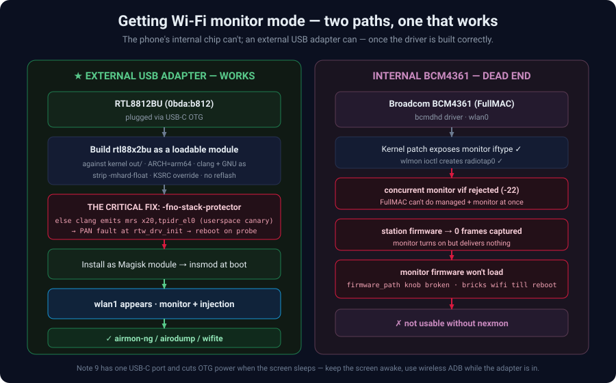

# USB Wi-Fi adapter — monitor mode + injection

The phone's **internal** Wi-Fi (Broadcom BCM4361, FullMAC) **cannot do usable monitor
mode** — see [the dead-end notes](#internal-chip--why-it-doesnt-work) below. The working
path is an **external USB adapter**. This folder builds the driver for an
**RTL8812BU (`0bda:b812`)** and installs it as a Magisk module so it is plug-and-play.



## Build + install

```bash
# 1) cross-compile the module against your kernel's out/ tree (edit paths at top)
./build-rtl88x2bu.sh
# -> produces rtl88x2bu/88x2bu.ko

# 2) sanity: the fix means NO userspace canary read (prints nothing = good)
aarch64-linux-android-objdump -d rtl88x2bu/88x2bu.ko | grep tpidr_el0

# 3) install as a boot-time Magisk module
adb push rtl88x2bu/88x2bu.ko /data/local/tmp/
adb push install-magisk-module.sh /data/local/tmp/
adb shell su -c 'sh /data/local/tmp/install-magisk-module.sh /data/local/tmp/88x2bu.ko'
```

Then plug the adapter via OTG — `wlan1` appears on its own.

## Use it

```bash
# inside the Kali chroot, as root:
iw dev wlan1 set type monitor       # DON'T use `airmon-ng check kill`:
ip link set wlan1 up                #   it kills Android's wpa_supplicant
wifite -i wlan1 --essid <your-net>  #   (chroot shares the netns) and drops wifi-adb
```

## The critical fix: `-fno-stack-protector`

Built normally, clang emits a **userspace stack-canary read** at `rtw_drv_init+0x24`:

```asm
mrs  x20, tpidr_el0      ; tpidr_el0 is a USERSPACE register
ldr  x8, [x20, #40]      ; dereferenced in kernel context
```

On probe the kernel dereferences `tpidr_el0` → **PAN fault**
(*"Accessing user space memory outside uaccess.h routines"*) → instant reboot.
Compiling the module with `-fno-stack-protector` (in both `CC` and `KCFLAGS`)
removes the canary read and the driver loads cleanly.

**Debug technique that cracked it:** `echo 0 > /proc/sys/kernel/panic_on_oops`
lets a driver oops kill `insmod` *without* rebooting, so you can read the full
backtrace from `dmesg` and `objdump -d` the faulting instruction.

Other build notes: command-line `KSRC=.../out` overrides the Makefile's `:=`;
strip `-mhard-float`/`-mfloat-abi=hard` (invalid on arm64); keep
`CONFIG_PLATFORM_I386_PC=y` for the cfg80211 defines; vermagic must match the
flashed kernel (`MODULE_SIG` off, `MODVERSIONS` on, `Module.symvers` present).

## Internal chip — why it doesn't work

On the Note 9's BCM4361 the kernel patch *exposes* a monitor iftype and `wlmon`
creates a `radiotap0` interface, but:

- a **concurrent** monitor vif next to the connected `wlan0` is rejected
  (`Invalid argument -22`) — a FullMAC chip can't do managed + monitor at once;
- on the **station firmware** airodump captures **0 frames**;
- the **monitor firmware** (`bcmdhd_mon.bin_b2`) can't be loaded through the
  `firmware_path` module param on this build (absolute path → `request_firmware`
  doubles the path and fails; basename → the param store mangles it) — and a
  failed load bricks Wi-Fi until a reboot.

Conclusion: internal monitor mode needs **nexmon**-patched firmware; for this
blueprint the external RTL8812BU is the only working capture path.

> **Gotchas:** the Note 9 has one USB-C port and **cuts OTG power when the screen
> sleeps** — keep the screen awake and use wireless ADB (`adb tcpip 5555`) while
> the adapter occupies the port.
